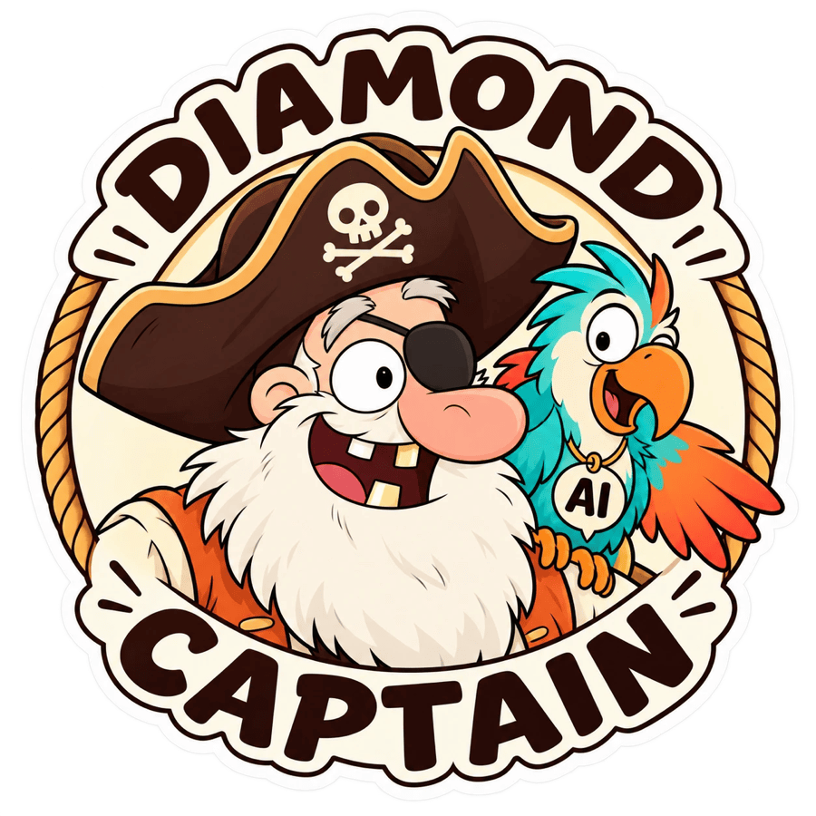

<p align="center"></p>

<h1 align="center">Diamond Captain — Your Triple Diamond needs a captain!</h1>

<div align="center">

[](https://github.com/rebosidium/diamond-captain/actions/workflows/checks.yml)
[](https://www.bestpractices.dev/projects/16014)
[](https://scorecard.dev/viewer/?uri=github.com/rebosidium/diamond-captain)
[](LICENSE)
[](https://github.com/rebosidium/diamond-captain/releases/latest)
[](https://github.com/rebosidium/diamond-captain/stargazers)<br>
[](distributions/openai/README.md)
[](distributions/claude-code/README.md)
[](distributions/opencode/README.md)<br>
[](docs/host-installation-routes.md)
[](docs/host-installation-routes.md)
[](distributions/grok-build/README.md)
[](distributions/perplexity/README.md)<br>
[](docs/process.md)
[](docs/guide/README.md)
[](docs/guide/Working-with-the-agent.md)
[](.agents/skills/diamond-captain/references/uxr.md)
[](docs/guide/README.md)
[](https://github.com/rebosidium/diamond-captain/releases)

</div>

Diamond Captain is an open-source skill that guides your AI agent through product and service design — from problem discovery to solution delivery and outcome review. You choose the direction and keep control of decisions.

Start at any phase, skip ahead or loop back. The agent keeps a checkpoint and distinguishes evidence from assumptions. It works with UI and non-UI tasks, using the tools and evidence you actually have.

## Start with your agent

Use this with a local agent such as Claude Code, Codex or **Gemini CLI**. Installation defaults to all your projects on this computer:

```text
Install Diamond Captain for all my projects:
https://github.com/rebosidium/diamond-captain/blob/main/INSTALL-FOR-AGENTS.md
```

Then describe your task. [Install for agents](INSTALL-FOR-AGENTS.md) · [Manual installation](START-HERE.md) · [User guide](docs/guide/README.md)

Already using the previous skill name? Follow the [migration guide](docs/migration.md) before adding another installation. Existing installations and project state are not automatically migrated.

## How you work together

You set the goal, scope and decision authority; the agent investigates, compares options and creates usable artifacts. At a handoff, you accept, revise or reopen the result separately from choosing the next phase. [Working with the agent](docs/guide/Working-with-the-agent.md).

[Resume a task](docs/guide/Task-continuity.md#resume-in-a-new-chat) — continue in a new chat from the saved checkpoint.

## Install

Package badges link to published distributions; route badges link to setup guidance. Perplexity client verification is pending.

Choose one active installation to avoid duplicate skill entries. Download the ZIP and matching checksums from the selected release. If you already use the previous skill name, follow the [migration guide](docs/migration.md) before adding a new copy; existing installations and user-profile settings are not automatically upgraded. The default is a personal installation for all your local projects in the selected agent; choose project-only setup explicitly. Existing copies still need update or migration authority.

| Host | Package and instructions | Invocation |
| --- | --- | --- |
| Codex / compatible OpenAI plugin tooling | [OpenAI 0.3.7](https://github.com/rebosidium/diamond-captain/releases/tag/openai-v0.3.7) · [Guide](distributions/openai/README.md) | `diamond-captain:diamond-captain`, or `$diamond-captain` for a native skill |
| Claude Code | [Claude Code 0.3.7](https://github.com/rebosidium/diamond-captain/releases/tag/claude-code-v0.3.7) · [Guide](distributions/claude-code/README.md) | `/diamond-captain` for a native skill, or `/diamond-captain:diamond-captain` for the plugin |
| OpenCode | [OpenCode 0.3.7](https://github.com/rebosidium/diamond-captain/releases/tag/opencode-v0.3.7) · [Guide](distributions/opencode/README.md) | Ask the agent to use `diamond-captain` |
| Gemini CLI (terminal) | Install the complete native skill for your user account (all local projects). [Setup guide](docs/host-installation-routes.md) | Request `diamond-captain`; verify with `/skills list` |
| Web-Gemini (browser) | Add this repository through **+ → Import code → GitHub**, where available. [Google's import guide](https://support.google.com/gemini/answer/14903178?hl=en) | Ask Gemini to use Diamond Captain for your task. This provides chat context; it does not install a CLI skill. |
| Cursor, Grok Build, Perplexity Computer | [Host installation routes](docs/host-installation-routes.md) | Use the host's supported native/plugin/import route and verify discovery |
| Manual | [Core 0.6.4](https://github.com/rebosidium/diamond-captain/releases/tag/v0.6.4) or the [complete core folder at v0.6.4](https://github.com/rebosidium/diamond-captain/tree/v0.6.4/.agents/skills/diamond-captain) | Follow the selected host's skill mechanism |

The packages contain the complete pinned core, including references and templates. Downloadable archives do not imply a marketplace listing or that every host/import surface has been runtime-tested.

Core **0.6.4** makes concrete method and execution-tool choices visible before dependent work. See the [changelog](CHANGELOG.md#064).

Host packages 0.3.7 contain complete pinned core 0.6.4, including its references, templates and helpers. Previous releases remain unchanged. Published downloads retain their pinned core; later development edits do not update an installed release. See [development previews](distributions/perplexity/README.md#development-core-preview) for testing a committed source snapshot separately.

## Three diamonds, six thinking modes

Each diamond broadens the question **↗**, then focuses the decision **↘**. Start where useful, skip ahead or loop back as evidence changes; these are thinking modes, not mandatory timeboxes.

| Phase | Diamond | Work toward |
| --- | --- | --- |
|  **1 · Discover ↗** | Problem | Understand needs, context and alternative causes. |
|  **2 · Define ↘** | Problem | Agree on the problem, scope and expected change. |
|  **3 · Develop ↗** | Solution | Compare different ways to help, including non-UI changes. |
|  **4 · Deliver ↘** | Solution | Select, validate and realize a usable solution. |
|  **5 · Deploy ↗** | Outcome | Observe real use, feedback and unexpected effects. |
|  **6 · Digest ↘** | Outcome | Assess evidence and decide what to keep, improve or revisit. |

Prepared work, a released change and a verified live outcome are distinct results. No specific model, design app or integration is required. [Read the full process](docs/process.md).

What a small task looks like: [a constructed end-to-end non-UI example](.agents/skills/diamond-captain/references/examples/worked-small-task.md), with evidence limits, human decisions and checkpoints.

## Learn and verify

- [User guide](docs/guide/README.md), [skill guide](.agents/skills/diamond-captain/README.md), [full process](docs/process.md).
- [UXR methods and handoff](.agents/skills/diamond-captain/references/uxr.md), [office tools](.agents/skills/diamond-captain/references/office-tools.md), [AI tools, MCP and agent discovery](.agents/skills/diamond-captain/references/tool-options.md#ai-tool-navigation) — optional references for the task at hand.
- [Compatibility and checks](docs/validation.md), [security](docs/security.md), [release and rollback](docs/releases.md).
- [Changelog](CHANGELOG.md), [migration from the previous skill name](docs/migration.md), [contributing](CONTRIBUTING.md).

## Security

See [security controls and assessment limits](docs/security.md) or [report a vulnerability privately](.github/SECURITY.md). Internal development records and execution logs are excluded.

## License

[MIT](LICENSE) © 2026 rebosidium. The original triple-diamond mark is included. Stage icons are from [Tabler Icons](assets/icons/README.md), with their [MIT notice](assets/icons/LICENSE). Linked third-party materials retain their licenses.

Static badges were generated by [Shields.io](https://shields.io/). The [MIT notice](assets/badges/LICENSE) is included.

Platform marks belong to their providers: [OpenAI](https://openai.com/brand/) and [Grok](https://x.ai/legal/brand-guidelines).
